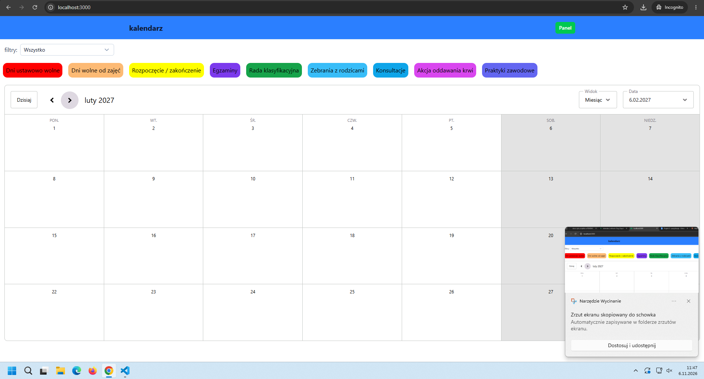

# Kalendarz roku szkolnego

Responsywna aplikacja webowa do prezentacji i zarządzania kalendarzem roku szkolnego. Uczniowie i nauczyciele widzą kalendarz z kolorowymi kategoriami wydarzeń, a administrator po zalogowaniu dodaje, edytuje i usuwa wydarzenia.



## Funkcje

**Widok publiczny**
- kalendarz miesięczny roku szkolnego (wrzesień – sierpień) z wydarzeniami oznaczonymi kolorami kategorii,
- filtrowanie wydarzeń według kategorii,
- legenda kategorii,
- widok dopasowany do telefonu: na wąskim ekranie kalendarz przełącza się na widok agendy, a miesiące można przewijać gestem w lewo i w prawo,
- zakres dat ograniczony do roku szkolnego.

**Panel administratora** (po zalogowaniu)
- logowanie i wylogowanie (email + hasło),
- dodawanie wydarzeń,
- tabela wydarzeń z filtrowaniem po kategorii,
- edycja wydarzenia bezpośrednio w wierszu tabeli (nazwa, daty, kategoria),
- usuwanie wydarzeń,
- zmiany zapisują się w bazie i od razu są widoczne w kalendarzu.

## Technologie

| Obszar | Narzędzie |
|---|---|
| Framework | [Nuxt](https://nuxt.com) |
| Interfejs | [Nuxt UI](https://ui.nuxt.com) + Tailwind CSS |
| Kalendarz | [Schedule-X](https://schedule-x.dev) |
| Baza danych i logowanie | [Supabase](https://supabase.com) (`@nuxtjs/supabase`) |

## Uruchomienie lokalne

### Wymagania

- Node.js (wersja zgodna z używaną wersją Nuxta)
- konto i projekt w Supabase

### Kroki

```bash
# 1. sklonuj repozytorium
git clone <adres-repozytorium>
cd kalendaz

# 2. zainstaluj zależności
npm install

# 3. skonfiguruj zmienne środowiskowe
cp .env.example .env
# uzupełnij wartości w pliku .env

# 4. uruchom serwer deweloperski
npm run dev
```

Aplikacja będzie dostępna pod adresem `http://localhost:3000`.

### Zmienne środowiskowe

| Zmienna | Opis |
|---|---|
| `SUPABASE_URL` | adres projektu Supabase |
| `SUPABASE_KEY` | publiczny klucz `anon` (publishable) |

Klucza `service_role` nie używaj w aplikacji i nie dodawaj go do repozytorium. Plik `.env` jest w `.gitignore`.

## Konfiguracja Supabase

1. Utwórz projekt w Supabase.
2. Utwórz tabelę `events`:

   | Kolumna | Opis |
   |---|---|
   | `id` | klucz główny |
   | `nazwa` | nazwa wydarzenia |
   | `start_data` | data rozpoczęcia (`YYYY-MM-DD`) |
   | `koniec_data` | data zakończenia (`YYYY-MM-DD`) |
   | `typ` | slug kategorii (patrz niżej) |

3. Włącz RLS i dodaj polityki: odczyt dla wszystkich, zapis tylko dla zalogowanych.

   ```sql
   alter table events enable row level security;

   create policy "publiczny odczyt" on events
     for select using (true);

   create policy "zapis tylko zalogowany" on events
     for all to authenticated
     using (true) with check (true);
   ```

4. W **Authentication → Users** utwórz konto administratora.
5. W **Authentication → Sign In / Providers** wyłącz **Allow new users to sign up**, żeby nikt obcy nie mógł założyć konta z uprawnieniami zapisu.

## Kategorie wydarzeń

| Slug | Nazwa | Kolor |
|---|---|---|
| `dniwolne` | Dni ustawowo wolne | `#FF0000` |
| `wolneodzajec` | Dni wolne od zajęć | `#FDBA74` |
| `rozpoczecie-zakonczenie` | Rozpoczęcie / zakończenie | `#FFFF00` |
| `egzaminy` | Egzaminy | `#7C3AED` |
| `rada` | Rada klasyfikacyjna | `#16A34A` |
| `zebrania` | Zebrania z rodzicami | `#38BDF8` |
| `konsultacje` | Konsultacje | `#0EA5E9` |
| `krew` | Akcja oddawania krwi | `#D946EF` |
| `praktyki` | Praktyki zawodowe | `#6366F1` |

Slugi muszą być zapisane małymi literami, bo Schedule-X używa ich jako nazw kolorów.

## Struktura projektu

```
.
├── app/
│   ├── components/
│   │   └── Calendar/
│   │       └── MonthCalendar.client.vue   # kalendarz (Schedule-X)
│   ├── pages/
│   │   ├── index.vue                      # widok publiczny
│   │   ├── login.vue                      # logowanie administratora
│   │   └── admin/
│   │       └── index.vue                  # panel administratora
│   └── app.vue
├── nuxt.config.ts
├── .env.example
└── README.md
```

Dostosuj drzewo do faktycznego układu katalogów w repozytorium.

## Roadmapa

Planowane i otwarte zadania są w zakładce [Issues](../../issues) oraz na tablicy [Projects](../../projects).

- [x] widok publiczny kalendarza z kategoriami i filtrem
- [x] logowanie administratora
- [x] dodawanie, edycja i usuwanie wydarzeń
- [x] przewijanie miesięcy gestem na telefonie
- [ ] zarządzanie latami szkolnymi (wybór aktywnego roku)
- [ ] zarządzanie kategoriami z poziomu panelu
- [ ] walidacja formularzy
- [ ] filtrowanie po roku szkolnym

## Wkład w projekt

1. Utwórz gałąź: `git checkout -b feature/nazwa-zmiany`.
2. Commituj w stylu `feat: ...`, `fix: ...`, `docs: ...`.
3. Otwórz Pull Request z krótkim opisem zmiany.

## Licencja

Do uzupełnienia (np. MIT).
